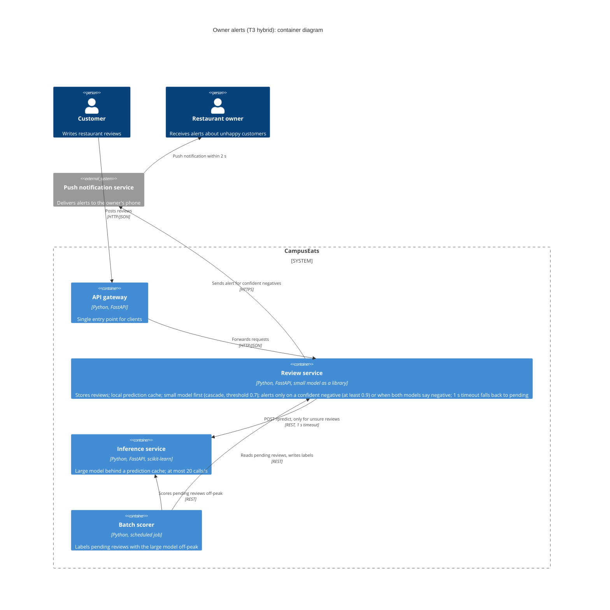

# Task 4: Deployment topologies and trade-offs

**Name:** Anapat Bunyapitaktamrong

**Student ID:** 01326172

This is **individual work**: each student completes and submits their own copy, in their own fork.

Design a deployment for the scenario below. Use your measurements from Tasks 0–3 as evidence: cite run names from `results/runs.csv`. Answer in English.

## Scenario: Owner alerts

When a customer posts a negative review, the restaurant owner gets a push notification within **2 seconds**. At the lunch peak, CampusEats receives **40 reviews per second**. A missed alert is acceptable, but a wrong alert (for example, "your customer is unhappy" when they are happy) makes owners stop trusting alerts and, in the end, ignore them.

Facts:

- The large model serves at most **20 calls per second** (4 calls at once × about 200 ms each), and every call costs money.
- The small model is fast and cheap enough to run anywhere, including inside the review service, but it is much less accurate on its own.

## Topologies and patterns to choose from

| | Topology | Where the model runs |
|---|---|---|
| T1 | Model as a service, synchronous | Inference service, called for each review (today's baseline) |
| T2 | Model as a library | Inside the review service, or on the device |
| T3 | Hybrid | Small model locally, large model as a remote service |
| T4 | Asynchronous / batch | Reviews are queued or stored, and scored later in bulk |

Combine one topology with any of the patterns from Tasks 1–3: **fallback**, **cascade** and **cache**.

## 1. Quality requirements

The three most important quality requirements for this scenario, each with a number where possible.

| # | Quality | Requirement |
|---|---|---|
| 1 | Accuracy (alert precision) | At least 90% of negative alerts are correct (the customer really was unhappy) |
| 2 | Latency | 95% of alerts reach the owner within 2 s of the review being posted |
| 3 | Capacity / cost | At the 40 reviews/s peak, at most 20 large-model calls/s (at most 50% of reviews go to the large model) |

## 2. Design

Your topology, the patterns you add, and a container-level diagram (C4 level 2). The C4 diagram must be written in Mermaid.

T3 hybrid: the small model runs in the review service, so the inference service only sees unsure reviews. Cascade (0.7) plus a cache in both services keeps large calls under 20/s (req 3); a 1 s timeout falls back to pending, scored later by an off-peak batch job (req 2). Alert only on a confident negative (>= 0.9) or when both models say negative (req 1); a missed alert is acceptable.

## 3. Evidence

Which runs support your choice? Show the numbers and the capacity arithmetic: how many large-model calls per second does your design need at the peak?

| Run | What it shows |
|---|---|
| t0-large | 93.5% accuracy but 100% large calls: at 40 reviews/s that is 40 large calls/s, double the 20/s limit (req 3) |
| t0-small | 72.5% accuracy: the small model alone would send too many wrong alerts (req 1) |
| t1-before | Without a timeout, 10% hung calls gave 26 errors and a 34.4 s run: hangs block everyone (req 2) |
| t1-after | With the 1 s timeout fallback: 0 errors, 20 pending, run back to 9.6 s, p95 1004 ms, inside 2 s (req 2) |
| t2-0.7 | Cascade at 0.7 keeps 93.0% accuracy but still uses 53% large calls: 40 x 0.53 = 21.2 calls/s, over the limit (req 3) |
| t3-cache | Cascade 0.7 plus cache: 93.0% accuracy, 38% large calls, p95 539 ms; 40 x 0.38 = 15.2 calls/s, under 20 (reqs 1-3) |

Capacity at the 40 reviews/s peak: large model only 40 calls/s (over the limit); cascade 0.7 21.2 calls/s (over); cascade 0.7 with cache 15.2 calls/s (under, 24% headroom). This assumes the load test's review mix (25% repeated short reviews); fewer repeats mean fewer cache hits and more large calls. Accuracy is a stand-in for alert precision, which was not measured. t3-cache had one cache in front of the cascade; a second cache in the review service can only lower the large-call rate.

## 4. ADR

An **architecture decision record (ADR)** is a short document that records one design decision: the situation that forced it (context), what you decided, and what follows from it, good and bad (consequences). Fill in the template below.

**Title:** Hybrid cascade with caching for owner alerts

**Status:** Proposed

**Context:** At the lunch peak CampusEats gets 40 reviews/s, and an owner must get an alert about a negative review within 2 s. Wrong alerts destroy trust, but a missed alert is acceptable. The large model is accurate (93.5%) but handles at most 20 calls/s and costs money per call; the small model is fast and almost free but only 72.5% accurate.

**Decision:** Use the T3 hybrid topology. The small model runs in the review service and answers first (cascade at 0.7); only unsure reviews go to the large model in the inference service. Both services keep a prediction cache, a 1 s timeout falls back to pending (scored later by an off-peak batch job), and an alert is sent only for a confident negative (>= 0.9) or when both models say negative.

**Consequences:**
- Positive: 15.2 large calls/s at the peak, under the 20/s limit with 24% headroom (t3-cache); 93.0% accuracy; p95 539 ms to a label, well inside 2 s; hung large-model calls no longer block reviews (t1-after).
- Negative: the capacity margin depends on the cache hit rate (35% on this review mix), so fewer repeated reviews mean more large calls; two caches must be invalidated on every model deploy; some negative reviews get no alert or a late one; alert precision was not measured directly.

**Alternatives considered:** at least one topology you rejected, and why.

> T1 (every review to the large model) was rejected: it needs 40 large calls/s at the peak, double the 20/s limit (t0-large). T2 (small model only) was rejected: at 72.5% accuracy it would send too many wrong alerts (t0-small).
