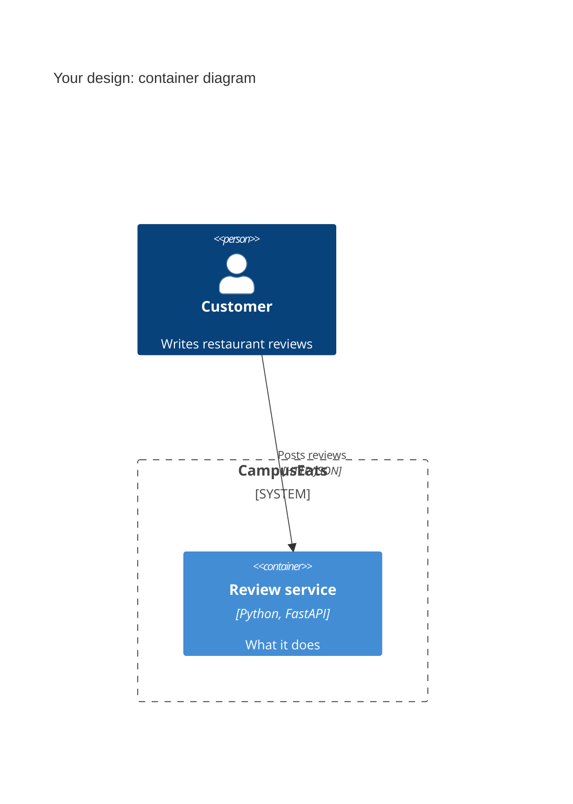

# Task 4: Deployment topologies and trade-offs

**Name:**

**Student ID:**

This is **individual work**: each student completes and submits their own copy, in their own fork.

Design a deployment for the scenario below. Use your measurements from Tasks 0–3 as evidence: cite run names from `results/runs.csv`. Answer in English.

## Scenario: Owner alerts

When a customer posts a negative review, the restaurant owner gets a push notification within **2 seconds**. At the lunch peak, CampusEats receives **40 reviews per second**. A missed alert is acceptable, but a wrong alert (for example, "your customer is unhappy" when they are happy) makes owners stop trusting alerts and, in the end, ignore them.

Facts:

- The large model serves at most **20 calls per second** (4 calls at once × about 200 ms each), and every call costs money.
- The small model is fast and cheap enough to run anywhere, including inside the review service, but it is much less accurate on its own.

## Topologies and patterns to choose from

| | Topology | Where the model runs |
|---|---|---|
| T1 | Model as a service, synchronous | Inference service, called for each review (today's baseline) |
| T2 | Model as a library | Inside the review service, or on the device |
| T3 | Hybrid | Small model locally, large model as a remote service |
| T4 | Asynchronous / batch | Reviews are queued or stored, and scored later in bulk |

Combine one topology with any of the patterns from Tasks 1–3: **fallback**, **cascade** and **cache**.

## 1. Quality requirements

The three most important quality requirements for this scenario, each with a number where possible.

| # | Quality | Requirement |
|---|---|---|
| 1 | | |
| 2 | | |
| 3 | | |

## 2. Design

Your topology, the patterns you add, and a container-level diagram (C4 level 2). The C4 diagram must be written in Mermaid.

## 3. Evidence

Which runs support your choice? Show the numbers and the capacity arithmetic: how many large-model calls per second does your design need at the peak?

| Run | What it shows |
|---|---|
| | |
| | |

## 4. ADR

An **architecture decision record (ADR)** is a short document that records one design decision: the situation that forced it (context), what you decided, and what follows from it, good and bad (consequences). Fill in the template below.

**Title:**

**Status:** Proposed

**Context:**

**Decision:**

**Consequences:**
- Positive:
- Negative:

**Alternatives considered:** at least one topology you rejected, and why.

>
